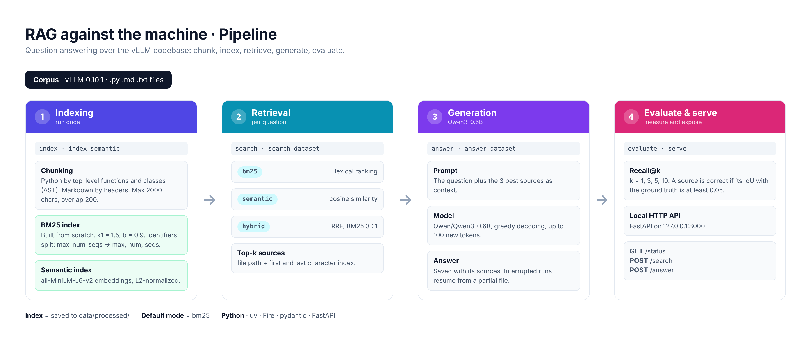

*This project has been created as part of the 42 curriculum by nocrespo.*

# RAG against the machine

A small Retrieval-Augmented Generation (RAG) system that answers questions
about a given database. It runs entirely on a CPU, with no external service: a hand-written
BM25 search engine, an optional semantic index and a hybrid ranking find the
right places in the repository, and a small local language model
(`Qwen/Qwen3-0.6B`) writes an answer from them. Everything can be used from
the command line or through a small local HTTP API.

## Description

Language models only know what they saw during training, and retraining them
every time the world changes is too expensive. RAG takes another route: when
a question arrives, the system first **retrieves** the most relevant pieces of
a document collection, then gives them to the model as context so that it can
**generate** an answer based on them.

   

The goal of this project is to build that pipeline for the vLLM repository
(about 2,900 files, of which the Markdown, text and Python files are used):

1. **Index** the repository: cut every file into chunks and build a search
   index (BM25, and optionally a semantic one).
2. **Search**: for a question, return the `k` best sources. A source is a
   file path plus a character range (`first_character_index`,
   `last_character_index`), so it points to an exact place in the corpus.
3. **Answer**: give the best sources to `Qwen/Qwen3-0.6B` and print an answer
   grounded in them.
4. **Evaluate**: measure the quality of the retrieval with recall@k.

Everything is driven by a command-line interface built with
Python Fire, and every file exchanged between the stages is validated
with Pydantic models.

### Features

- Chunking adapted to the file type: Markdown/text by header sections,
  Python by top-level functions and classes.
- BM25 inverted index written from scratch, with a tokenizer that understands
  code identifiers (`snake_case` and `CamelCase`).
- Index saved as JSON, loaded in about one second.
- Local answer generation with `Qwen/Qwen3-0.6B`, in a strict "use only the
  context" prompt.
- Batch commands for whole datasets with progress bars (`tqdm`).
- `answer_dataset` saves its progress after every question and can be
  resumed after an interruption.
- Graceful handling of bad inputs (empty query, `k=0`, `k=abc`, missing files,
  malformed JSON, missing or corrupted index): the CLI prints a clear message
  on the error output instead of a traceback.
- **Semantic embeddings:** a vector index built with
  `all-MiniLM-L6-v2` on CPU.
- **Hybrid retrieval:** the BM25 and semantic rankings are merged
  into one list with Reciprocal Rank Fusion.
- **Local HTTP API:** `serve` exposes search and answer generation
  over HTTP (FastAPI and uvicorn).

## Instructions

### Requirements

- Linux (the project is tested on the 42 campus machines).
- Python 3.13 or later (as declared in `pyproject.toml`).
- [uv] as the package manager.
- Free disk space: the dependencies (`torch`, `transformers`) and the model
  weights take several gigabytes. The first `answer`, `answer_dataset` or
  `serve` downloads `Qwen/Qwen3-0.6B` (about 1.2 GB) from Hugging Face. The
  semantic features (`index_semantic`, `--mode semantic`, `--mode hybrid`)
  download `sentence-transformers/all-MiniLM-L6-v2` (about 90 MB) the first
  time.

### Data layout

The corpus and the datasets are provided with the subject; they are data, not
part of the code. They must be at the following locations, from the root of
the repository:

```
data/raw/vllm-0.10.1/                    the vLLM repository to index
data/datasets/UnansweredQuestions/       questions without solution
data/datasets/AnsweredQuestions/         questions with ground truth
data/processed/                          the indexes (created by `index` and `index_semantic`)
data/output/search_results/              output of `search_dataset`
data/output/search_results_and_answer/   output of `answer_dataset`
```

### Installation

```bash
make install
```

### Makefile rules

| Rule | What it does |
|---|---|
| `make install` | Install the dependencies with `uv sync`. |
| `make run ARGS="<command> [options]"` | Run the program: `uv run python -m src <command> [options]`. |
| `make debug ARGS="..."` | Same as `run`, under the Python debugger (`pdb`). |
| `make lint` | `flake8 .` and `mypy .` with the flags required by the subject. |
| `make lint-strict` | `flake8 .` and `mypy . --strict`. |
| `make clean` | Remove `__pycache__`, `.mypy_cache` and `.pytest_cache`. |
| `make fclean` | `clean` and remove the `.venv`. |

### Running the full pipeline

```bash
# 1. Build the BM25 index (once)
uv run python -m src index --max_chunk_size 2000

# 2. Search a whole dataset
uv run python -m src search_dataset --dataset_path data/datasets/UnansweredQuestions/dataset_docs_public.json --k 10 --save_directory data/output/search_results/UnansweredQuestions

# 3. Measure the recall (own evaluator; the official one is the moulinette)
uv run python -m src evaluate \
    --student_search_results_path data/output/search_results/UnansweredQuestions/dataset_docs_public.json
    --dataset_path data/datasets/AnsweredQuestions/dataset_docs_public.json

# 4. Generate the answers
uv run python -m src answer_dataset --student_search_results_path data/output/search_results/UnansweredQuestions/dataset_docs_public.json --save_directory data/output/search_results_and_answer/UnansweredQuestions
```

The default mode is `bm25`, so this flow needs only the BM25 index.

### Using the bonus features

```bash
# Build the semantic index (slower, run it once)
uv run python -m src index_semantic --max_chunk_size 2000

# Search with the semantic or the hybrid ranking
uv run python -m src search "How do I load a LoRA adapter?" --mode semantic
uv run python -m src search "How do I load a LoRA adapter?" --mode hybrid

# Compare the three modes: one output directory per mode, because the result
# file has the name of the dataset and would be overwritten otherwise
for mode in bm25 semantic hybrid; do
    uv run python -m src search_dataset \
        --dataset_path data/datasets/UnansweredQuestions/dataset_docs_public.json \
        --mode $mode --k 10 \
        --save_directory data/output/search_results/UnansweredQuestions/$mode
done

#  Rec@ll with each mode
for mode in bm25 semantic hybrid; do
    echo "== $mode =="
    uv run python -m src evaluate \
        --student_search_results_path data/output/search_results/UnansweredQuestions/$mode/dataset_docs_public.json \
        --dataset_path data/datasets/AnsweredQuestions/dataset_docs_public.json
done

# Start the local HTTP API (see "Local HTTP API" below)
uv run python -m src serve --mode hybrid
```

The semantic and hybrid modes need the semantic index, which must be built
with the **same `--max_chunk_size`** as the BM25 index. Both are saved in
`data/processed/`.

### Command reference

| Command | Options (default) | Description |
|---------|-------------------|-------------|
| `index` | `--max_chunk_size` (2000, from 1 to 2000), `--root` (`data/raw/vllm-0.10.1`), `--end_path` (`data/processed`) | Chunk the corpus and save the BM25 index. |
| `index_semantic` | `--max_chunk_size` (2000), `--root`, `--end_path` | Chunk the corpus and save the semantic (embeddings) index. Bonus 1. |
| `search <query>` | `--k` (5), `--index_path` (`data/processed`), `--mode` (`bm25`) | Print the top-k sources of one query, with an excerpt. `--mode` is `bm25`, `semantic` or `hybrid`. |
| `search_dataset` | `--dataset_path`, `--save_directory`, `--k` (10), `--index_path`, `--mode` (`bm25`) | Search all the questions of a dataset and save a `StudentSearchResults` JSON file with the same name as the dataset. |
| `answer <query>` | `--k` (5), `--index_path`, `--mode` (`bm25`) | Search one query and print the generated answer. `k` sources are given to the model. |
| `answer_dataset` | `--student_search_results_path`, `--save_directory` | Generate an answer for every question of a search results file and save a `StudentSearchResultsAndAnswer` JSON file. The model reads the 3 best sources of each question. |
| `evaluate` | `--student_search_results_path`, `--dataset_path` | Print recall@1, 3, 5 and 10 against a ground-truth dataset. |
| `serve` | `--host` (`127.0.0.1`), `--port` (8000), `--index_path`, `--mode` (`bm25`), `--with_answer` (`True`) | Start the local HTTP API. Bonus 5. |

No path is hard-coded: all input and output paths are command-line options.
With `make run`, put the arguments in `ARGS`, for example:

```bash
make run ARGS="search 'How do I load a LoRA adapter?' --k 3"
```

Results are printed on the standard output. Errors and warnings are printed
on the standard error, so `... search "lora" > result.txt` never mixes them
with the results.

### Local HTTP API

`serve` starts a server that exposes the system over HTTP, so that it can be
used by something other than the CLI. It listens on `127.0.0.1` (this machine
only) and loads the index and the language model **once**, when it starts.

```bash
uv run python -m src serve                          # BM25 search and answers
uv run python -m src serve --mode hybrid --port 8001
uv run python -m src serve --with_answer=False      # search only, starts fast
```

| Endpoint | Description |
|----------|-------------|
| `GET /status` | Returns `{"status": "ok"}` when the server is running. |
| `POST /search` | Body `{"query": "...", "k": 5}`. Returns a `MinimalSearchResults`: `question_id`, `question` and `retrieved_sources`. |
| `POST /answer` | Same body. Returns a `MinimalAnswer`: the same fields plus the generated `answer`. |

`k` is optional (5 by default) and must be between 1 and 20. Each response
gets a new random `question_id`. Interactive documentation, where the
endpoints can be tried from the browser, is served at
`http://127.0.0.1:8000/docs`.

```bash
curl http://127.0.0.1:8000/status

curl -X POST http://127.0.0.1:8000/search \
     -H "Content-Type: application/json" \
     -d '{"query": "How do I load a LoRA adapter?", "k": 3}'

curl -X POST http://127.0.0.1:8000/answer \
     -H "Content-Type: application/json" \
     -d '{"query": "What HTTP endpoint loads a LoRA adapter?", "k": 3}'
```

Errors never are a traceback:

| Code | When |
|------|------|
| 400  | Empty query or invalid argument. |
| 422  | The body does not match the model (missing `query`, `k` out of range or not a number). Generated by FastAPI. |
| 500  | Any other error (for example the model failed). |
| 503  | `/answer` was called on a server started with `--with_answer=False`. |

Generation is serialised with a lock, because the language model is shared by
all the requests: two `/answer` calls at the same time are answered one after
the other. Searching does not need the lock.

### Troubleshooting

- **`No space left on device` during `make install`.** The `.venv` is created
  inside the project, and `torch` is large. On a machine with a small home
  quota, move the environment and the caches to a bigger disk before
  installing:
  ```bash
  export UV_CACHE_DIR=/sgoinfre/students/<login>/uv-cache
  export HF_HOME=/sgoinfre/students/<login>/hf-cache
  export UV_PROJECT_ENVIRONMENT=/sgoinfre/students/<login>/rag-venv
  export UV_LINK_MODE=copy
  ```
- **`answer_dataset` is interrupted.** Run the same command again: the
  answers already generated are kept in a `<name>.partial.json` file next to
  the output and are reused. The partial file is deleted when everything
  finishes without errors. If you change anything that affects the answers
  (prompt, number of sources), delete the partial file first, otherwise the
  old answers are reused.


## System architecture

```
                              INDEXING (once)
 data/raw/vllm-0.10.1 --> chunking --+--> BM25 index ----> data/processed/
   (.py, .md, .txt)     (src/chunking)|    (src/indexing)    bm25_index.json
                                      |
                                      +--> semantic index -> data/processed/
                                           (src/semantic)    semantic_index.pt
                                           [bonus 1]

                              RETRIEVAL
 question --> retrieval (src/retrieval.py) --- mode bm25 -----> BM25 ranking
                                           --- mode semantic -> vector ranking
                                           --- mode hybrid ---> both rankings
                                                  |             merged by RRF
                                                  |             (src/hybrid.py)
                                                  |             [bonus 2]
                              top-k sources (file + char range)
                                                  |
              +-----------------------+-----------+-----------------+
              v                       v                             v
   evaluation (recall@k)    generation (Qwen3-0.6B)        HTTP API (src/api.py)
   src/evaluation.py        src/generation.py              /search and /answer
                                      |                    [bonus 5]
                       answer grounded in the sources
```

| Module | Role |
|---|---|
| `src/__main__.py` | Entry point: starts the CLI with Fire. |
| `src/cli.py` | The eight commands (`RagCLI`), argument checks, progress saving. |
| `src/chunking/` | `markdown_chunker.py` and `python_chunker.py` cut the files; `chunk_utils.py` splits long sections with overlap. |
| `src/indexing.py` | Tokenizer, corpus reading, and the `BM25Index` class (build, search, save, load). |
| `src/semantic.py` | `SemanticIndex`: MiniLM embeddings of the chunks and cosine search (bonus 1). |
| `src/hybrid.py` | `hybrid_retrieval`: Reciprocal Rank Fusion of two rankings (bonus 2). |
| `src/retrieval.py` | `Retrieval`: loads the index (or indexes) of a mode and answers queries or whole datasets. |
| `src/generation.py` | `Generator`: builds the prompt and calls the language model. |
| `src/api.py` | `create_app`: the FastAPI application served by `serve` (bonus 5). |
| `src/evaluation.py` | Recall@k with the same overlap rule as the moulinette. |
| `src/files.py` | Reading and atomic writing of files; validated loading of JSON files. |
| `src/models.py` | Pydantic models of all the data exchanged between stages, including the API request. |
| `src/errors.py` | Exception hierarchy (`RagError` and its children). |

The generation and semantic modules (and therefore `torch` and
`transformers`) are imported only when a command needs them, so `index`,
`search` and `search_dataset` in `bm25` mode start fast.

## Chunking strategy

Only `.py`, `.md` and `.txt` files are read (1,846 of the 2,881 files of the
repository). Each file is cut into chunks of **at most 2,000 characters** (the
limit of the subject). Every chunk keeps its exact character range in the
original file, which is what a source is made of.

**Markdown and text files** are cut by structure:

1. The headers (`#` to `######`) are found, ignoring lines that start with `#`
   inside fenced code blocks (they are shell comments, not titles).
2. Each header starts a section that lasts until the next header.
3. A section shorter than 300 characters is merged with the next one, as long
   as the result does not exceed the maximum size. This avoids thousands of
   tiny chunks made of a title and one line.
4. A section longer than the maximum is cut in pieces of 2,000 characters
   that **overlap by 200 characters**, so a sentence at a boundary appears
   whole in at least one chunk.

**Python files** are parsed with the `ast` module:

1. Each top-level function or class (decorators included) starts a section
   that lasts until the next top-level definition.
2. The code before the first definition (imports, constants) is a section of
   its own.
3. Long sections are cut with the same 200-character overlap.
4. If the file has a syntax error, it is treated as one section and cut by
   size.

**Context for the index.** The text that is indexed for each chunk is its
relative path and its section titles (if any) followed by its content. This
way a query that mentions a file name or a section title can find the chunk
even if the words are not in its body. The stored source is still the plain
character range of the original file. The BM25 and the semantic index use the
same text.

The corpus produces about 18,000 chunks.

## Retrieval method

Three retrieval modes are available. `bm25` is the default and the one used by
the mandatory part; `semantic` and `hybrid` are the bonus modes.

### BM25 (lexical)

The ranking function is **BM25**, written from scratch.

**Tokenization.** The text is lowercased and split into words. Code
identifiers are kept whole **and** split into parts: `max_num_seqs` gives
`max_num_seqs`, `max`, `num` and `seqs`; `LLMEngine` gives `llmengine`, `llm`
and `engine`. This way a natural-language question ("max number of seqs") can
match a code name, and an exact identifier in the question still matches
exactly. There is no stop-word list: the IDF already gives very little weight
to words that are everywhere.

**Index.** An inverted index maps each token to the chunks where it appears
and how many times (`token -> {chunk_id: count}`), plus the length of each
chunk. The number of chunks that contain each token (df), the IDF and the
average chunk length are computed once, at build time or at load time.

**Score.** For a query, only the chunks that share at least one token with it
are scored, by adding the BM25 score of each query token:

```
score(q, d) = sum over tokens t of q:
              IDF(t) * f(t,d) * (k1 + 1) / (f(t,d) + k1 * (1 - b + b * |d| / avgdl))

IDF(t) = ln( (N - n(t) + 0.5) / (n(t) + 0.5) + 1 )
```

`f(t,d)` is the number of times `t` appears in chunk `d`, `|d|` its length in
tokens, `avgdl` the average length, `N` the number of chunks and `n(t)` the
number of chunks that contain `t`. The parameters are `k1 = 1.5` and
`b = 0.9`. The chunks are sorted by score (ties are broken by chunk id, so
the result is deterministic) and the first `k` are returned as sources.

**Persistence.** The index is saved as `data/processed/bm25_index.json`
(about 17 MB). The file has a version number: an index from another version
is rejected with a message asking to rebuild it. It is written to a temporary
file first and then renamed, so an interrupted indexing never leaves a broken
index.

### Semantic search

BM25 only matches words. A question that paraphrases an idea ("how do I add a
fine-tuned adapter at runtime") can miss a chunk that uses other words. The
semantic index compares **meanings** instead.

- **Model.** `sentence-transformers/all-MiniLM-L6-v2`, a small model that runs
  on CPU, loaded with `transformers`. Each chunk (context + content, the same
  text as BM25) becomes a vector of 384 numbers: the mean of the token
  vectors, ignoring the padding, normalised to length 1.
- **Search.** The query is embedded the same way and compared with every
  chunk by dot product. As all the vectors have length 1, this is the cosine
  similarity. The `k` highest scores are returned.
- **Speed.** The texts are sorted by length before being embedded in batches
  of 32, so a batch has little padding. A `tqdm` bar shows the progress.
- **Limit.** The model reads at most 256 tokens per chunk. A chunk of 2,000
  characters, especially code, often has more, so the end of long chunks is
  not seen by the semantic index.
- **Persistence.** `data/processed/semantic_index.pt` (a `torch` file with the
  version, the model name, the sources and the vectors). It is loaded with
  `weights_only=True` and written through a temporary file, like the BM25
  index. It is built by a separate command, `index_semantic`, because
  embedding the whole corpus is much slower than building the BM25 index.

### Hybrid retrieval

The two rankings are good at different things: BM25 at exact identifiers and
flags, the semantic index at paraphrases. The hybrid mode merges them with
**weighted Reciprocal Rank Fusion** (RRF):

```
score(chunk) = sum over the rankings that contain the chunk of weight / (60 + position)
```

where `position` starts at 1, the weight of the BM25 ranking is 3 and the
weight of the semantic ranking is 1. RRF only uses positions, not the scores,
which cannot be compared (BM25 scores and cosine similarities have different
scales). The constant 60 is the usual value: it softens the weight of the
first positions. A chunk found by both indexes gets two contributions and
rises in the final list.

The weights come from measurement. With equal weights (1:1), a wrong result at
the top of the weaker semantic ranking pushed correct BM25 results down, and
the hybrid mode was worse than BM25 alone. Giving BM25 three times the weight
recovers most of that loss, but the hybrid mode still does not beat BM25 on
the public datasets (see *Performance analysis*).

To have something to merge, each index returns `3 * k` sources; the fusion
sorts them and keeps the first `k`. Two sources are the same chunk if they
have the same file and the same character range, so both indexes must have
been built with the same `--max_chunk_size`.

## Answer generation

The answer is produced by `Qwen/Qwen3-0.6B` with the Hugging Face
`transformers` library, on CPU, with greedy decoding (the same input always
gives the same answer), thinking mode disabled and at most 100 new tokens.

**Prompt strategy.**

- The system message tells the model to answer using **only** the given
  context, never its own knowledge, in at most two sentences, and to reply
  with a fixed sentence (*"I do not have enough information to answer the
  question."*) when the context does not contain the answer.
- The context is the text of the best sources, numbered `[1]`, `[2]`, `[3]`.
  `answer_dataset` gives the model the 3 best sources of each question
  (see *Performance analysis* for why).
- In `answer_dataset`, an empty question gets the fixed sentence directly,
  without calling the model. A question whose sources cannot be read gets it
  too.

## Performance analysis

### Retrieval quality

The BM25 figures were measured with the official moulinette on the two public
datasets (about 100 questions each), with `max_chunk_size = 2000` and
`k = 10`. The comparison between retrieval modes was measured with the
`evaluate` command of this project, which applies the same overlap rule as the
moulinette.

**BM25 (mandatory part):**

| Dataset | Recall@1 | Recall@3 | Recall@5 | Recall@10 | Required Recall@5 |
|------|--------|--------|--------|--------|------|
| Docs | 63.0 % | 79.0 % | 82.0 % | 86.0 % | 80 % |
| Code | 52.5 % | 71.7 % | 79.8 % | 85.9 % | 50 % |

Both datasets are above the thresholds of the subject. The margin is large for
code questions and small for docs questions (2 points above the threshold),
so any change in the chunking or in the ranking must be measured again on the
docs dataset.

**Comparison of the three modes (recall@5, bonus 1 and 2):**

Docs:

| Mode | Recall@1 | Recall@3 | Recall@5 | Recall@10 |
|--------|--------|---------|---------|-------------|
| `bm25` | 63.0 % | 79.0 % | 82.0 % | 86.0 % |
| `semantic` | 33.0 % | 58.0 % | 67.0 % | 73.0 % |
| `hybrid` 3:1 | 58.0 % | 76.0 % | 81.0 % | 86.0 % |

Code:

| Mode | Recall@1 | Recall@3 | Recall@5 | Recall@10 |
|--------|--------|----------|----------|-----------|
| `bm25` | 52.5 % | 71.7 % | 79.8 % | 85.9 % |
| `semantic` | 26.3 % | 32.3 % | 45.5 % | 54.5 % | 
| `hybrid` 3:1 | 47.5 % | 67.7 % | 77.8 % | 84.8 % |

On this corpus the semantic index alone is clearly weaker than BM25,
especially on code. The questions contain exact identifiers, flags and
endpoints that BM25 matches literally, while `all-MiniLM-L6-v2` is a small
general-purpose model that reads at most 256 tokens of each chunk. With equal
weights, Reciprocal Rank Fusion is worse than BM25 alone: a wrong result at
the top of the weaker ranking pushes correct BM25 results down. Giving BM25
three times the weight recovers most of the loss (+6 points of recall@5 on
code), but the hybrid mode still does not beat BM25: the semantic index does
not add correct chunks that BM25 has not already found among its candidates
(the three modes have the same recall@10 on docs). For this reason `bm25`
stays the default mode, the only one the mandatory part needs, and the
semantic and hybrid modes are optional.

### Answer generation time

Generation was the slow part: the first version took about 25-30 s per
question on a campus machine. Printing the number of tokens and the time of each question showed
(on a test file of 10 questions) that:

- the time grows in a straight line with the **length of the prompt**, about
  0.016 s per input token: reading the context is what costs;
- writing the answer (8 to 40 tokens) is cheap in comparison.

So the lever is the size of the context. Giving the model the 3 best sources
instead of 5 reduced the average prompt from about 1,470 to about 920 tokens,
and the time from about 25 s to about 15 s per question (about 25 minutes for
100 questions). The price is recall: recall@3 is lower than recall@5 (79 % vs
82 % for docs, 71.7 % vs 79.8 % for code), so sometimes the useful source is
ranked 4th or 5th and the model never sees it.
